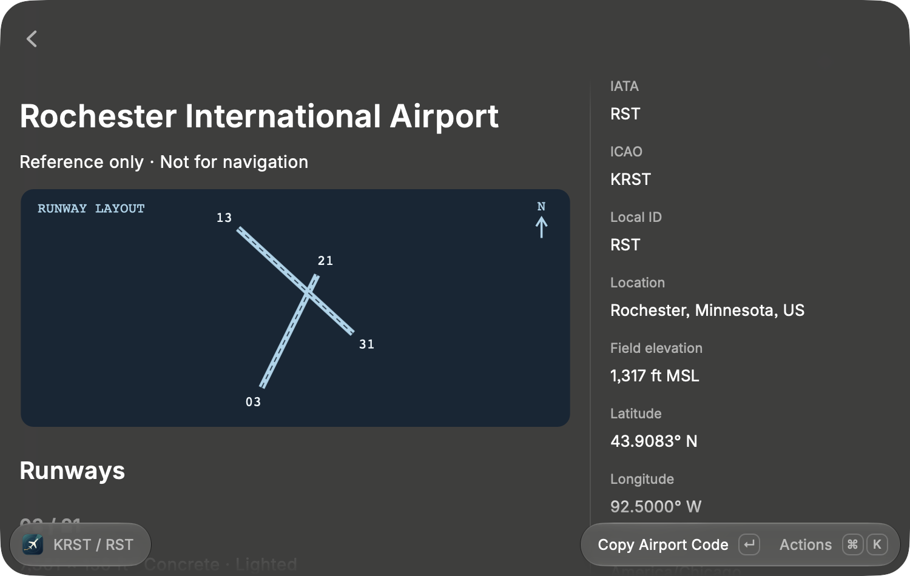
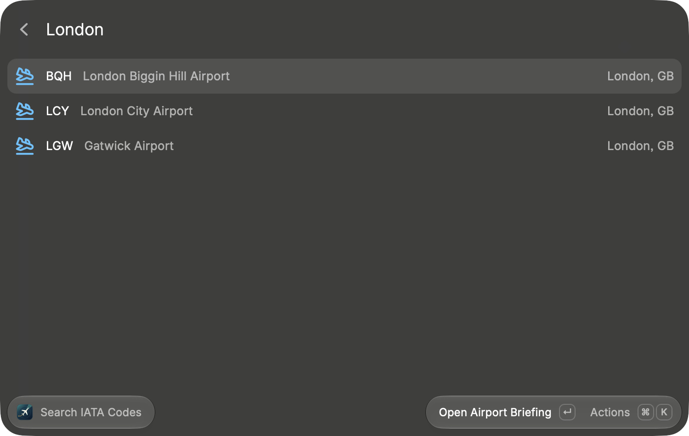
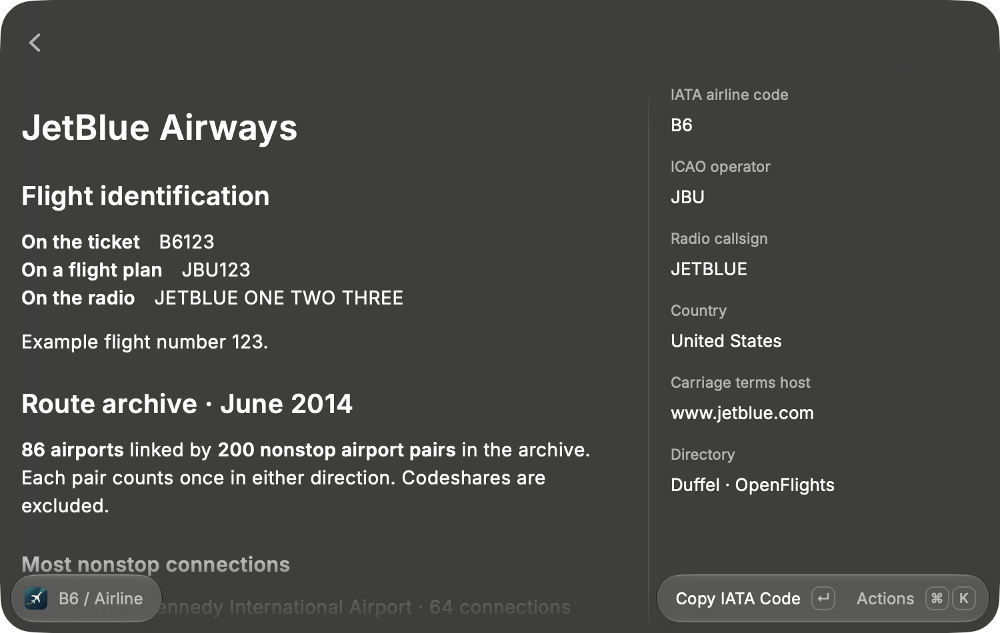
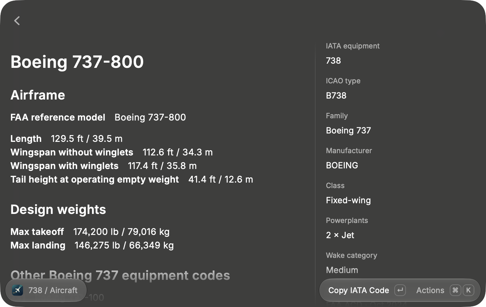

# IATA Lookup for Raycast

Type `RST` to see Rochester’s runways and tower frequency, `B6` to see how a JetBlue flight would identify itself on the radio, or `738` to look up the Boeing 737-800’s wingspan. Search airports, airlines, and aircraft or equipment by code, name, or city. All lookups run on your Mac using the bundled data.



## Search

Open **Search IATA Codes** in Raycast and type a booking code, airport ICAO code, name, or city. The list updates with each keystroke and shows up to three matches. An exact code takes priority. Press **Return** to open a result, **⌘K** for copy actions, or **Esc** to go back.



## Explore a result

**Airports** show runway dimensions, surfaces and lighting, radio frequencies, associated navigation aids, elevation, coordinates, and time zone where available. The extension draws its north-up runway diagrams locally from published runway endpoints. For aviation reference only. Use current official charts for navigation.

**Airlines** show how the booking code, ICAO operator code, and spoken callsign fit together. Where available, the June 2014 OpenFlights archive shows the carrier’s busiest stations by number of distinct nonstop connections.



**Aircraft** show the IATA equipment code, ICAO type, and related variants. Unambiguous FAA reference models also include available dimensions, engine details, wake category, and design weights in US and metric units.



## Run locally

You’ll need Raycast for macOS, Git, Node.js 22.14 or later, and an existing Raycast SDK CLI (`ray`). The CLI comes with `@raycast/api`. If you already develop Raycast extensions, you can use the full path to an existing project’s `node_modules/.bin/ray` in place of `ray`. [Raycast developer guide](https://developers.raycast.com/basics/getting-started)

```sh
git clone https://github.com/daveonkels/raycast-iata-lookup.git
cd raycast-iata-lookup
ray develop
```

Open Raycast and search for **Search IATA Codes**. The development command watches for edits. To build the extension bundle into a local directory, run `ray build -e dist -o dist`. The repository includes all lookup data and requires no API key or background service.

## Updates

On the first of each month, GitHub checks the source data and proposes changes for review. Each briefing shows the source dates that apply to that record. [Refresh runs](https://github.com/daveonkels/raycast-iata-lookup/actions/workflows/refresh.yml) · [Maintainer guide](docs/data.md)

### Set up daily updates on macOS

After **Search IATA Codes** works in Raycast, stop the development watcher with **Ctrl-C**. From the cloned repository, run the installer as your normal macOS user. It needs Python 3.9 or newer, Node.js and the same installed Raycast CLI you used above.

```sh
python3 tools/macos/install-updater.py
```

If `ray` is outside your shell’s PATH, pass its full path. For example, if you use the CLI from another extension:

```sh
python3 tools/macos/install-updater.py --ray "/path/to/extension/node_modules/.bin/ray"
```

Your Mac checks the public `main` branch at **9:00 AM local time** while you’re logged in. If the Mac sleeps through that time, it checks after waking. When data changes, the updater builds it with the code from your checkout’s local `main` branch, verifies the search and profiles, and replaces the installed bundle in one step. If a download or build fails, Raycast keeps using the last working bundle and the updater tries again on its next scheduled run. Searches work offline.

Keep the checkout and build tools available. Rerun the installer if you move the checkout, replace your Node.js or Raycast CLI installation, or want a newer version of the updater. For extension **code** updates, pull `main` and rebuild with `ray develop`.

To run a check immediately, then inspect its status and log:

```sh
launchctl kickstart "gui/$(id -u)/com.daveonkels.raycast-iata-update"
launchctl print "gui/$(id -u)/com.daveonkels.raycast-iata-update"
tail -n 20 "$HOME/Library/Application Support/IATA Lookup Updater/updater.log"
```

The log records installations and errors. An already-current check exits successfully without adding a log entry. To remove the daily job and keep the extension installed:

```sh
python3 tools/macos/install-updater.py --uninstall
```

## Data and license

The extension code is [MIT licensed](LICENSE). The booking catalog comes from a Duffel snapshot. Airfield data comes from OurAirports, airline and equipment records from OpenFlights, and aircraft specifications from the FAA. Coverage varies by record. The bundled data carries its source terms, including ODbL 1.0 for OpenFlights-derived profile data. [Source revisions and rebuild instructions](docs/data.md) · [Bundled attribution](assets/PROFILE-SOURCES.txt)
